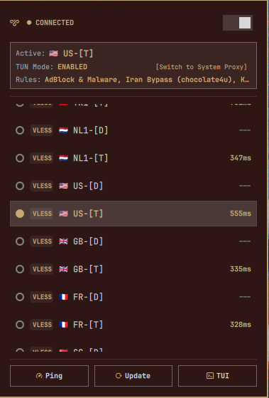

# omaxrs


The Omarchy bar plugin for [xrs](https://github.com/mahdjalili/xrs), a lightweight Xray proxy client.

This project was extracted from the `plugin/` directory of xrs. The plugin is maintained here; the proxy client remains in the xrs repository.

## UI preview



## Features

- View connection status and the active server in the bar.
- Left-click to open the proxy panel; right-click to connect or disconnect.
- Switch servers and toggle TUN mode.
- View active routing rules and test server latency.
- Update subscriptions and open the xrs terminal interface.

## Requirements

- [xrs](https://github.com/mahdjalili/xrs) installed and available on the desktop session's `PATH`, with proxy nodes configured.
- Omarchy Quattro with its Quickshell plugin host (`qs.Commons` and `qs.Ui`). These QML files are not a standalone Quickshell application.
- `foot` for the panel's **TUI** action.

The plugin uses the xrs CLI, including `xrs status --json`, to read status and perform actions. It does not bundle or install xrs or Xray-core. Install and configure xrs using its [upstream instructions](https://github.com/mahdjalili/xrs) before enabling this widget. TUN support and any required privileges are managed by xrs, not by this plugin.

## Installation

On an Omarchy desktop, run:

```bash
omarchy plugin add https://github.com/mahdjalili/omaxrs.git --enable
```

The widget is named **omaxrs** and defaults to the right bar section. Its plugin ID is `io.github.mahdjalili.omaxrs`.

Left-click the widget to open its panel; right-click to connect or disconnect. The panel provides server selection, TUN switching, latency tests, subscription updates, and the xrs TUI.

### Migrating from the old `xrs` plugin ID

Before installing this version, disable the previous widget to avoid duplicate widgets and status polling:

```bash
omarchy plugin disable xrs
```

If the old plugin was installed through Omarchy's plugin manager, remove it with `omarchy plugin remove xrs`. For a manually installed copy, back it up and remove it using the original installation procedure. Then install omaxrs with the command above. The new ID has its own bar placement; existing `xrs` widget settings are not migrated automatically. The xrs client and its configuration are unaffected by this ID change.

## Update

```bash
omarchy plugin update io.github.mahdjalili.omaxrs
```

## Disable or remove

```bash
# Hide the widget while keeping the plugin installed.
omarchy plugin disable io.github.mahdjalili.omaxrs

# Disable and remove the plugin checkout.
omarchy plugin remove io.github.mahdjalili.omaxrs
```

Removing the widget does not stop an active xrs connection or remove xrs, Xray-core, subscriptions, or client configuration. Disconnect using the widget or xrs before removal if needed.

## Troubleshooting

If the widget has no status or nodes, run `xrs status --json` in a terminal and confirm that xrs is installed, configured, and available on the desktop session's `PATH`. If the TUI action does not open, confirm that `foot` is installed. Client connection and TUN errors should be diagnosed with xrs directly.

## Development

From the repository directory, validate its manifest on an Omarchy system:

```bash
omarchy plugin validate .
```

Validation checks the manifest and entry points; it does not exercise the QML or xrs integration. Before release, test the widget on a running Omarchy desktop: status, panel opening/closing, connect/disconnect, server selection, TUN switching, latency tests, subscription updates, TUI launch, and removal.

Marketplace submission preparation and the draft issue body are in [SUBMISSION.md](SUBMISSION.md) and [docs/marketplace-submission.md](docs/marketplace-submission.md).

## Files

- `manifest.json`: plugin metadata and bar widget entry point.
- `BarWidget.qml`: bar button and panel loader.
- `Panel.qml`: proxy controls and xrs CLI integration.
- `logo.png`: shared xrs and omaxrs plugin logo.
- `preview.png`: example of the plugin UI.

## License

MIT, see [LICENSE](LICENSE).
